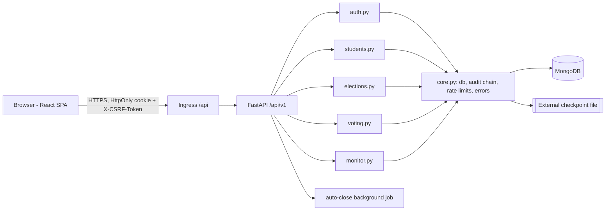
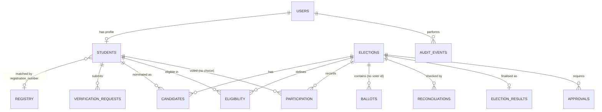
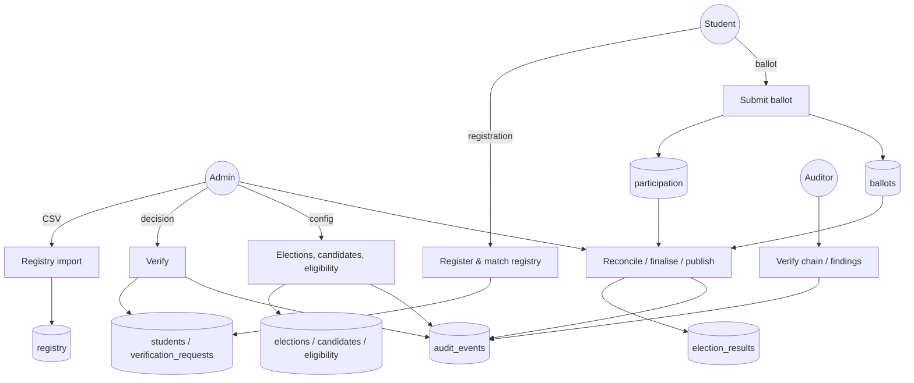
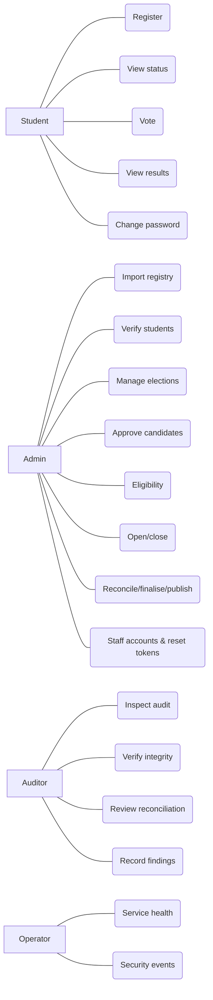
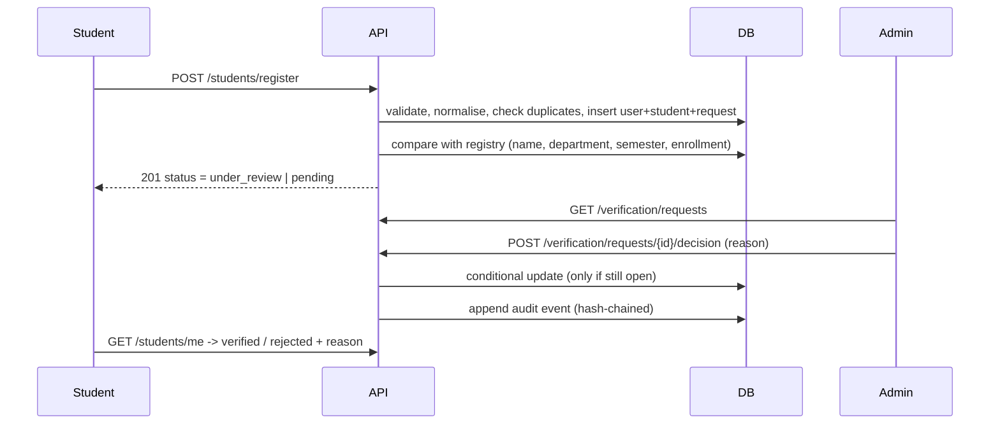
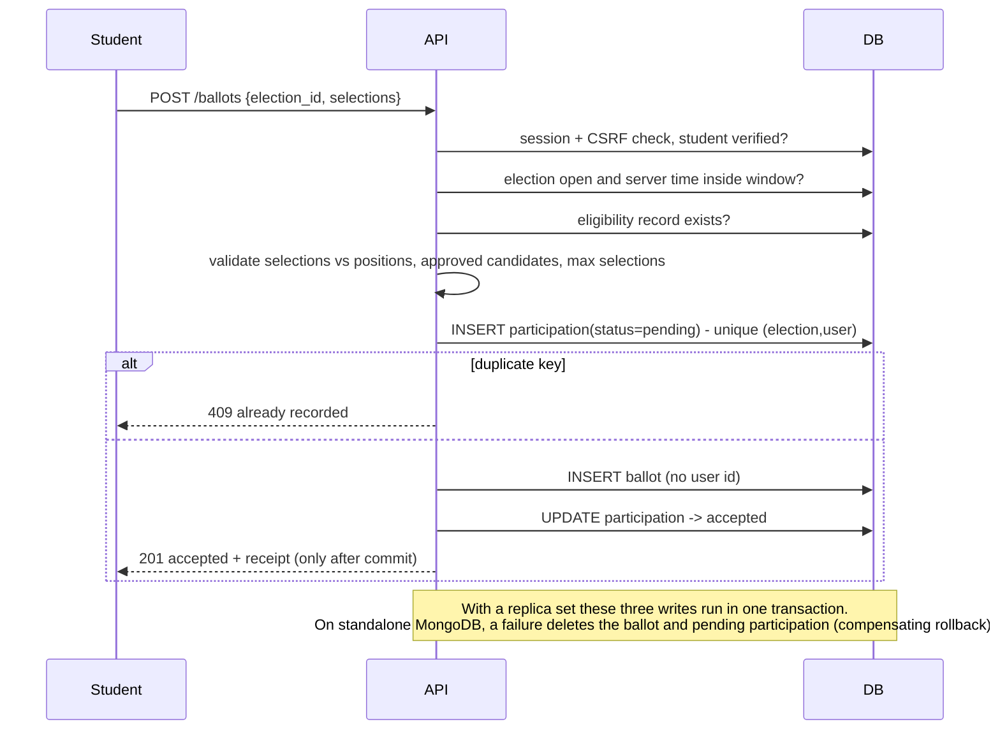
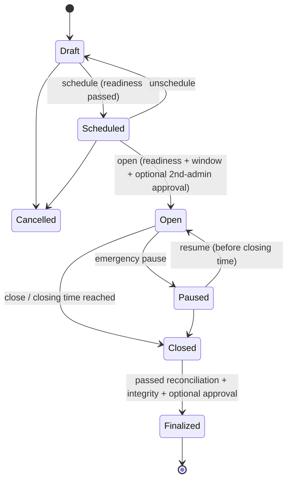

# VoteSecure — Project Report (BCA Minor Project)

Secure Online College Election Management System
Built and developed by Hriata_khuptong

## 1. Abstract
VoteSecure is a web application that a college can use to run student elections under control. Students register with their college registration number. Administrators check each registration against an official registry that an authorised college representative imports from CSV. Elections move through a lifecycle that the server enforces. Each eligible student can submit exactly one ballot per election, and a database uniqueness constraint guarantees this. Results are counted on the server only after voting closes, reconciled against participation records, finalised once, and published according to each election's disclosure policy. Every administrative action is written to a SHA-256 hash-chained audit log. HMAC-signed checkpoints of that log are stored outside the database.

## 2. Problem statement
Paper and spreadsheet elections in colleges are slow and hard to audit. Voter eligibility is hard to check. Duplicate voting and counting errors are hard to detect. Simple online forms make things worse: anyone can submit, submissions can be repeated, and there is no record of who changed the configuration or the results.

## 3. Objectives
- Verify student identity against an authorised registry before a student can vote.
- Enforce one accepted ballot per eligible student per election, even under concurrent requests.
- Enforce the election lifecycle and voting window using authoritative server time.
- Keep ballot choices separate from voter identity in ordinary application access paths.
- Give tamper-evident auditability, reconciliation and controlled finalisation.
- Give separate role-based dashboards for students, administrators, auditors and system operators.

## 4. Scope and limitations
In scope: the features above, CSV registry import, TOTP MFA for staff, admin-issued password-reset tokens, turnout analytics and operational monitoring.
Out of scope or limited: email delivery (by owner choice, so the "Awaiting Email Verification" status is not used), candidate photographs (no object storage is configured), cryptographic end-to-end verifiability, coercion resistance, and independent security certification.

## 5. Existing-system limitations
Manual ballots need physical presence and manual counting. Generic form tools cannot verify identity, stop duplicates, enforce time windows or keep an audit trail.

## 6. Proposed system
This is a three-tier web application: a React single-page app, a FastAPI REST API (`/api/v1`) and MongoDB. The server performs every security decision. The UI only presents state.

## 7. Functional requirements
- FR1 Student registration with validation and duplicate detection.
- FR2 Registry CSV import with preview, validation, explicit confirmation and an audited commit.
- FR3 Verification queue with approve or reject decisions, a recorded reason, and suspend or reactivate.
- FR4 Election CRUD (draft only), positions, policies and disclosure.
- FR5 Candidate nomination (verified students only, scope-checked), approval, rejection and withdrawal, all in draft only.
- FR6 Eligibility list generation, locking and audited post-lock changes.
- FR7 Lifecycle actions: schedule, unschedule, open, pause, resume, close, cancel and extend, with a readiness checklist.
- FR8 Ballot submission with review and confirmation, a receipt, and participation status.
- FR9 Reconciliation, finalisation, publication and two-person approval.
- FR10 Audit viewer, chain verification, signed checkpoints and auditor findings.
- FR11 Turnout analytics, plus operator health, metrics and security events.

## 8. Non-functional requirements
Security (OWASP Top 10 controls), privacy, integrity, accessibility (semantic HTML, labels, focus rings), responsive design (mobile first), maintainability (modular routers) and observability (request IDs, metrics).

## 9. System architecture

## 10. Database schema (MongoDB collections)
| Collection | Key fields | Constraints |
|---|---|---|
| users | _id, email, role, status, password_hash (Argon2id), must_change_password, mfa_* | unique email (partial) |
| students | _id = user id, registration_number, full_name, department, semester, verification_status, registry_match, verified_by | unique registration_number |
| registry | registration_number, full_name, department, semester, enrollment_status, import_id | unique registration_number |
| registry_previews / registry_imports | parsed rows (temporary, 30 min TTL) / summaries | TTL index |
| verification_requests | user_id, status, match_result, reviewer_id, review_notes, decided_at | index status |
| elections | title, scope, departments, semesters, opens_at, closes_at, timezone, positions[], policy{}, state, eligibility_locked, result_status | state transitions guarded by conditional updates |
| candidates | election_id, position_id, student_user_id, status | unique (election, position, student) |
| eligibility | election_id, user_id, status, reason, history[] | unique (election, user) |
| participation | election_id, user_id, status, accepted_at | **unique (election, user)**: the duplicate-vote guard |
| ballots | _id (random UUID), election_id, selections[], receipt_hash, recorded_on (date only) | no user reference; unique receipt_hash |
| reconciliations | election_id, checks[], totals, counts, passed | |
| election_results | election_id, totals, integrity_hash, audit_head_hash, published | unique election_id (no overwrite) |
| approvals | election_id, action, requested_by, decided_by, status | requested_by ≠ decided_by enforced |
| audit_events | seq, ts, event_type, actor_id, target, meta, prev_hash, hash | unique seq |
| audit_checkpoints, audit_findings, sessions (TTL), reset_tokens, login_failures (TTL), rate_limits (TTL), mfa_challenges (TTL), security_events, request_metrics, job_status | supporting | |

MongoDB has no foreign keys. Referential checks happen in application code before each write. For example, candidates must reference a verified student, and ballots must reference approved candidates of the same election. Uniqueness is enforced by database indexes.

## 11. ER diagram

## 12. Data-flow diagram (level 1)

## 13. Use-case diagram

## 14. Sequence: student verification

## 15. Sequence: ballot submission

## 16. Election state transitions

Result status: Reconciliation Pending → Reconciliation Failed or Awaiting Approval → Finalized → Published.

## 17. Authentication and authorisation design
- Argon2id hashing (argon2-cffi). Login failures return the generic message "Invalid credentials." A dummy hash check runs for unknown accounts to reduce timing differences.
- Server-side sessions: a random 256-bit token is set as an HttpOnly, Secure, SameSite=Lax cookie. Only the SHA-256 of the token is stored. Sessions have a 30-minute idle timeout and an 8-hour absolute timeout. Sessions rotate on login, password change and MFA enablement. All sessions are revoked on password change or reset and when an account is disabled.
- CSRF uses the double-submit pattern: the `vs_csrf` cookie must match the `X-CSRF-Token` header on every state-changing request.
- Throttling: 5 failures per identifier causes a 15-minute lock. There are also per-IP limits for login, registration, reset and MFA, and per-user limits for ballots.
- Initial administrator: provisioned idempotently from `INITIAL_ADMIN_EMAIL` and the `INITIAL_ADMIN_PASSWORD` secret, with a forced password change. If the secret is missing, provisioning is skipped and an error is logged. No default password exists.
- RBAC: `require(*roles)` runs on every protected route. Roles are student, admin, auditor and operator. Public registration can only create students, and unknown request fields are rejected (`extra="forbid"`).
- TOTP MFA for staff accounts is optional, with replay protection (last used time-step).

## 18. Security threat model (summary)
| Threat | Control |
|---|---|
| Duplicate voting or race conditions | Unique (election, user) index on participation; checked before and enforced at insert |
| Forged ballots | Server validation against approved candidates, positions and limits; extra fields rejected; client timestamps ignored |
| Voting outside the window | State plus server-time check; auto-close job |
| Privilege escalation | Server RBAC, no role field in public input, staff created only by admins, last-admin protection |
| CSRF / XSS | Double-submit token, SameSite cookies, React output encoding, strict input regexes, API CSP `default-src 'none'` |
| Injection | Typed Pydantic models (no operator objects), escaped regex search, no string-built queries |
| CSV formula injection | Cells starting with = + - @ are rejected on import and escaped on export |
| Brute force | Lockout and rate limits, MFA |
| Tampering by insiders | Hash chain plus HMAC checkpoints in a separate file, reconciliation, unique finalisation record |
| Ballot privacy leaks | No user id or exact time on ballots; choices never logged or audited; operators cannot reach results |

Residual risk: a privileged attacker with database **and** checkpoint-key access can rewrite history. A database administrator could also correlate the insertion order of ballots and participation records.

## 19. Test plan and actual results
Automated suite: `backend/tests/test_votesecure.py` (pytest with the FastAPI TestClient). It runs against a separate `votesecure_test` database with synthetic data, and the database is dropped afterwards.
Covered: valid and invalid login, the generic error for unknown accounts, lockout, the NoSQL operator-injection attempt, forced first-login change, session invalidation, expired and reused reset tokens, duplicate registration, invalid details and XSS payload, registry mismatch, role injection on registration, student self-approval and export denial, role boundaries for auditor and operator, CSRF, election validation, the lifecycle bypass attempt, candidate scope checks, the invalid or foreign candidate, too many selections, the forged timestamp field, the not-yet-open and closed election cases, transaction failure with rollback, duplicate and retried submissions, six concurrent submissions (exactly one accepted), ineligible and unverified students, no totals during voting, audit-chain tamper detection, finalisation blocked after an integrity failure, reconciliation detecting an injected ballot, the finalisation and publication immutability checks, two-person approval with a different administrator, unsafe upload rejection, oversized body rejection and security headers.
**Actual result (2026-10-09): 31 passed, 0 failed, 0 skipped.** An independent end-to-end browser test of all user roles also passed. No external penetration test or certification has been performed.

## 20. Deployment procedure
See `/app/README.md`.

## 21. Backup and recovery plan
`scripts/backup.sh` runs `mongodump` (gzip archive plus SHA-256) and writes a status JSON that the operator dashboard reads. To restore, use `mongorestore --archive=<file> --gzip` into an empty database, then run audit verification. Keep the checkpoint file (`AUDIT_CHECKPOINT_DIR`) on separate storage, and back it up separately from the database.

## 22. Privacy limitations
Separating collections is not cryptographic anonymity. Database-level access could correlate participation and ballot records by insertion order. The receipt proves that a ballot was included, not what it contained. Sessions and security logs keep salted IP hashes. The system does not claim end-to-end verifiability or coercion resistance.

## 23. Known issues and future enhancements
- Email verification and email password reset are not configured (by owner choice).
- Candidate photographs are not supported (no object storage).
- A MongoDB replica set is recommended so that votes are recorded in true multi-document transactions. The code detects this automatically.
- Planned: per-rule candidate eligibility templates, ranked-choice ballots, signed checkpoints sent to an external WORM store, a frontend CSP via the hosting reverse proxy.
- Deviations from the brief: the original brief asked for Node/Express, TypeScript and PostgreSQL. The project was built on React (JavaScript, CRA) + FastAPI + MongoDB with the owner's consent. The same invariants are kept through unique indexes, conditional state updates and server validation.

## 24. Conclusion
VoteSecure shows the complete life of a college election: registry-based identity verification, eligibility management, ballots protected against duplicates, auditable administration, and reconciled, immutable results. It describes its privacy and security guarantees accurately.

## 25. Viva questions and answers
1. **How do you prevent double voting?** A unique compound index on `participation(election_id, user_id)`. The insert either succeeds once or fails with a duplicate-key error. No frontend check is involved.
2. **Why are participation and ballot separate?** So that normal queries can never join a voter to their choices. The ballot document has no user id, and its timestamp is reduced to the date.
3. **What does the hash chain guarantee?** Any edit, deletion or reordering of a past event breaks the chain at that event. With external HMAC checkpoints, even a fully rebuilt chain is detected when compared.
4. **Why Argon2id?** It is a memory-hard password hash and the OWASP-recommended default. It resists GPU and ASIC cracking.
5. **How is CSRF prevented with cookie sessions?** SameSite=Lax cookies plus a double-submit token header that the server compares with the token stored in the session.
6. **What happens if the server crashes mid-vote?** With transactions, nothing is committed. Without them, the compensating rollback removes partial records. A leftover pending participation record is flagged by reconciliation as "incomplete" and blocks finalisation until it is investigated.
7. **Can an admin change results?** There is no update endpoint. `election_results` is unique per election, and finalisation re-verifies reconciliation and the audit chain.
8. **Why two-person approval?** It prevents one administrator from opening or finalising an election alone. The approver must be a different account.
9. **How is time handled?** Only server UTC time decides the voting window. Client timestamps are rejected as unknown fields.
10. **How do eligibility and verification differ?** Verification confirms identity. Eligibility is a per-election record derived from the scope rules and locked before the election opens.
